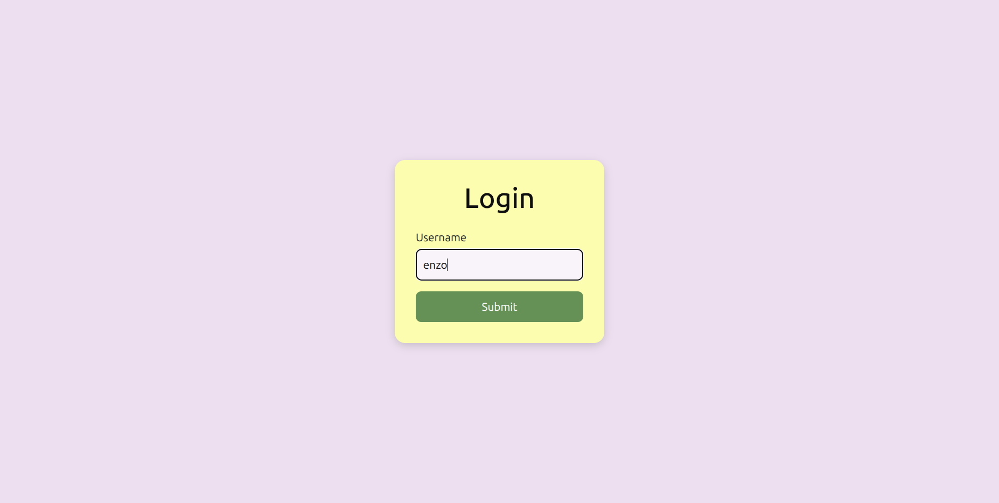
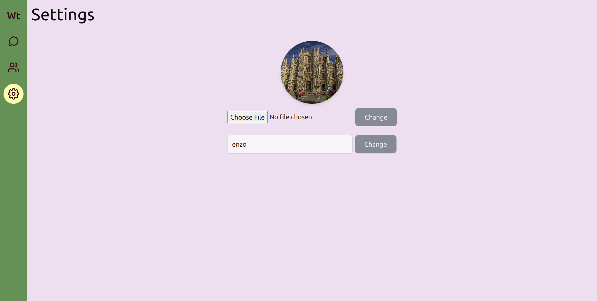
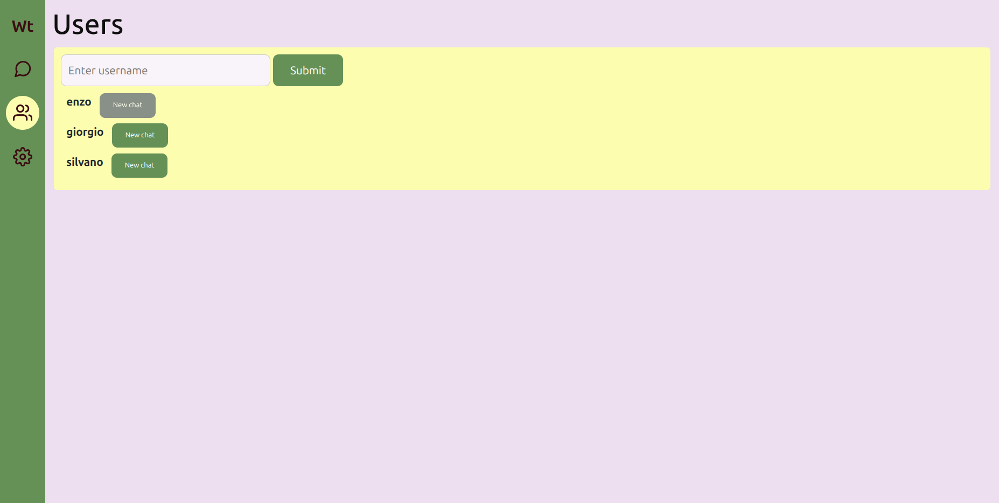
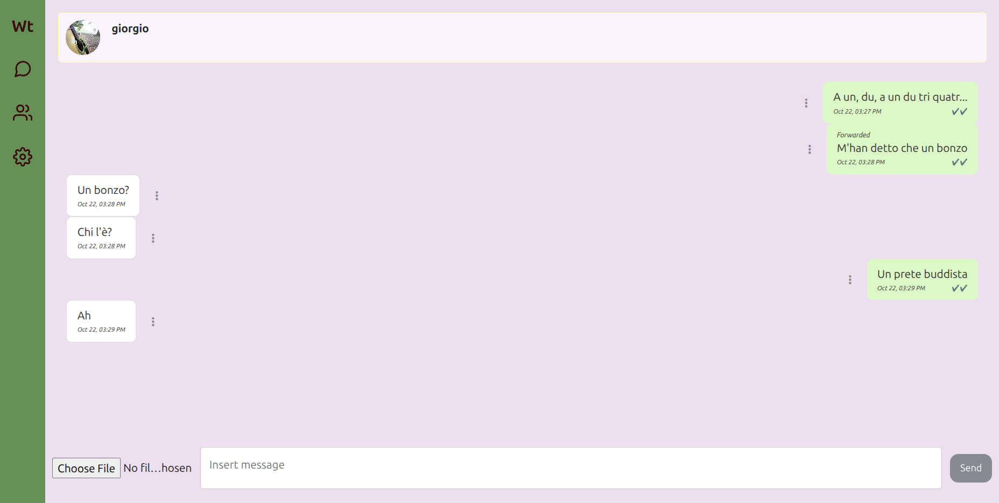
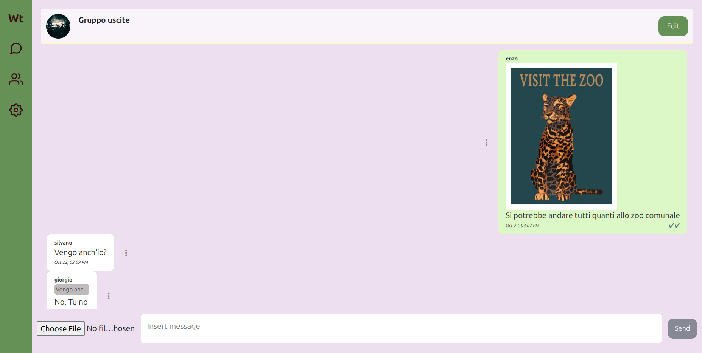
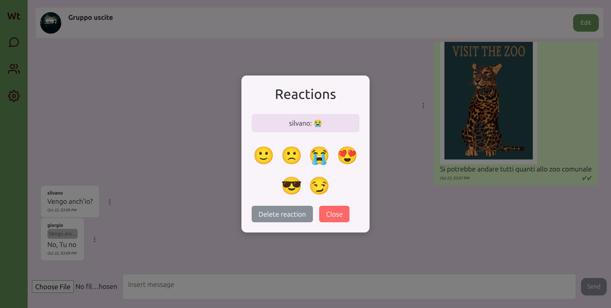
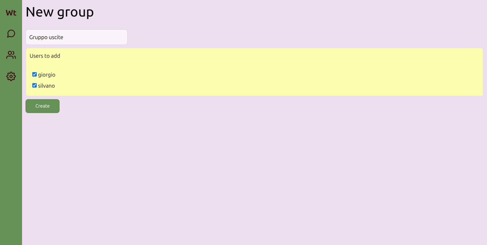
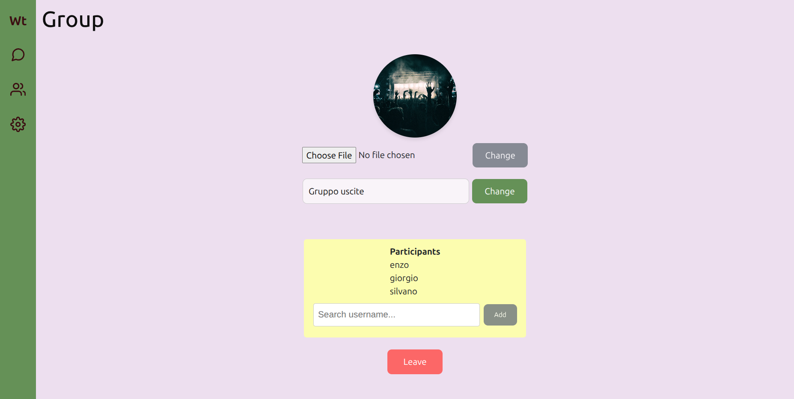

# WASAtext

## Table of contents
- [About](#about)
- [Project feature](#project-features)
- [Project structure](#project-structure)
- [Run the project](#run-the-project)
- [License](#license)

## About
Connect with your friends effortlessly using WASAtext! Send and receive messages, whether one-on-one
or in groups, all from the convenience of your PC. Enjoy seamless conversations with text or GIFs and
easily stay in touch through your private chats or group discussions.

> [!WARNING]  
> WASAtext is a university project focused on creating APIs, managing the backend, and building a functional frontend. 
> The login, graphic design, and security features are overlooked in order to focus on the rest.

## Project features

### Login

A login page allows users to register or log in to their accounts


### User profile

A user can change their username or profile picture.


### Users

A user can see and create new chat with other users.


### Private or group chats

A user can chat with other users in private or group chats by sending text messages and photos, forwarding messages, replying to others' messages, or reacting to messages.




### Group

A user can create a group, leave it, or change its name and picture, and add other participants.




## Project structure

* `cmd/` contains all executables; Go programs here should only do "executable-stuff", like reading options from the CLI/env, etc.
	* `cmd/healthcheck` is an example of a daemon for checking the health of servers daemons; useful when the hypervisor is not providing HTTP readiness/liveness probes (e.g., Docker engine)
	* `cmd/webapi` contains an example of a web API server daemon
* `demo/` contains a demo config file
* `doc/` contains the documentation (usually, for APIs, this means an OpenAPI file)
* `service/` has all packages for implementing project-specific functionalities
	* `service/api` contains an example of an API server
	* `service/globaltime` contains a wrapper package for `time.Time` (useful in unit testing)
* `vendor/` is managed by Go, and contains a copy of all dependencies
* `webui/` is an example of a web frontend in Vue.js; it includes:
	* Bootstrap JavaScript framework
	* a customized version of "Bootstrap dashboard" template
	* feather icons as SVG
	* Go code for release embedding

Other project files include:
* `open-node.sh` starts a new (temporary) container using `node:20` image for safe and secure web frontend development (you don't want to use `node` in your system, do you?).

## Run the project

> [!WARNING]  
> This project was developed in a GNU/Linux environment.

Follow these instructions to run WASAtext:

* Build the project:

	* Open the terminal and navigate to the project folder.

	* Run the following commands to build the project:
		```bash
		docker build -t wasa-text-frontend:latest -f Dockerfile.frontend .
		docker build -t wasa-text-backend:latest -f Dockerfile.backend .
		```
* Run the project:

	* Open two terminal windows and navigate to the project folder in both windows.

	* Run the following command in a terminal window to run the backend:
		```bash
		docker run -rm -it -p 3000:3000 --name wt-backend wasa-text-backend:latest
		```

	* Run the following command in a terminal window to run the frontend:
		```bash
		docker run -rm -it -p 8080:80 --name wt-frontend wasa-text-frontend:latest
		```

* Open your browser, type `localhost:8080`, and the website will appear. 
(To simulate additional users, open multiple tabs — one for each user).

> [!IMPORTANT]
> Both commands must be executed for the site to work. If you make changes to either the backend or the frontend, stop both processes with Ctrl+C and rerun the commands above starting with `docker build ...` to rebuild the site.

## License

*Copyright© 2026 Giuseppe Nardini*\
This program is licensed under the [AGPL-3.0](LICENSE) license.
The images used in the project presentation are licensed under [CC0 Public Domain](https://creativecommons.org/publicdomain/zero/1.0/) license.